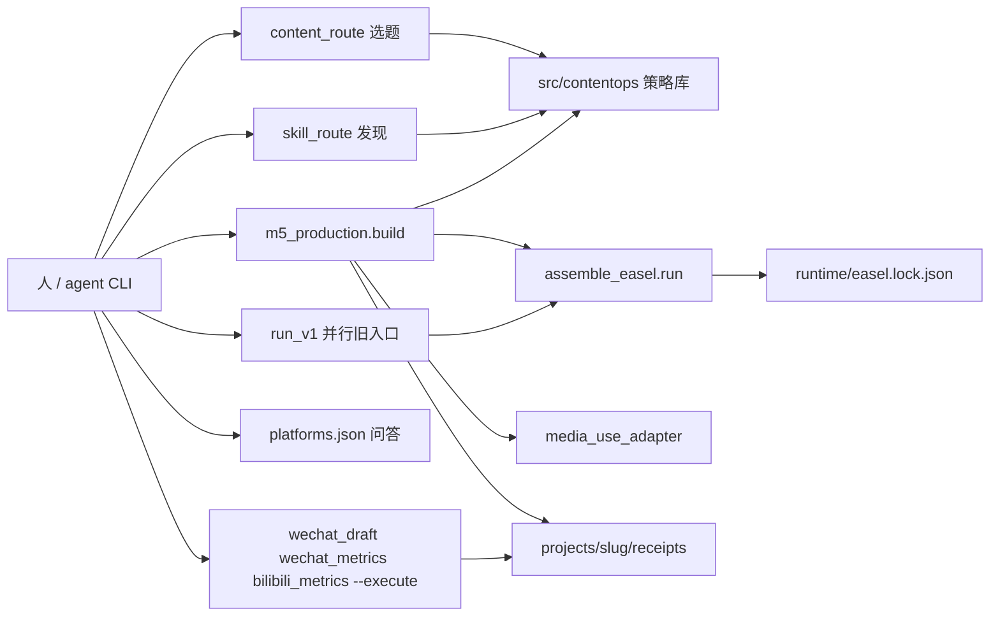
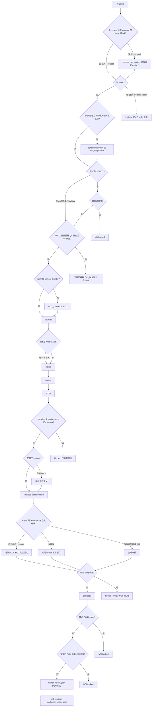
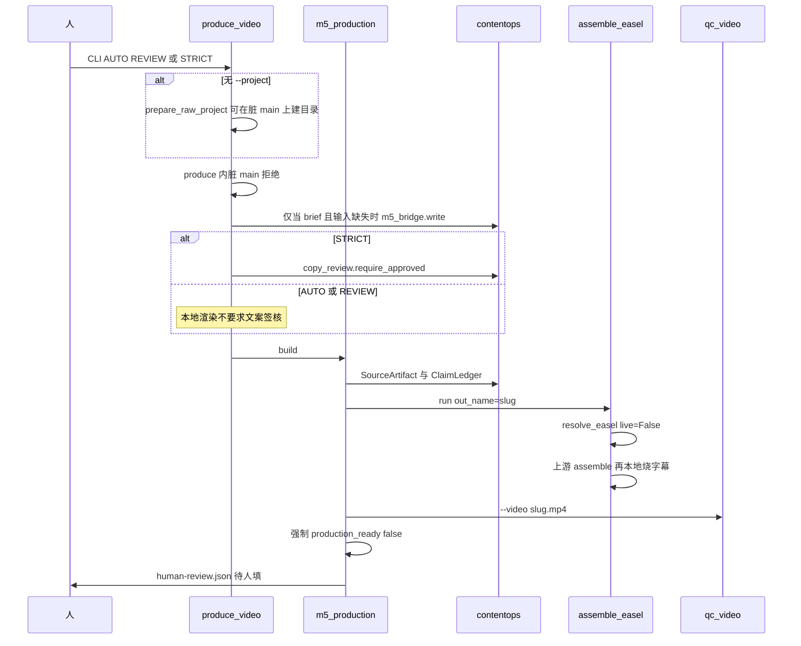
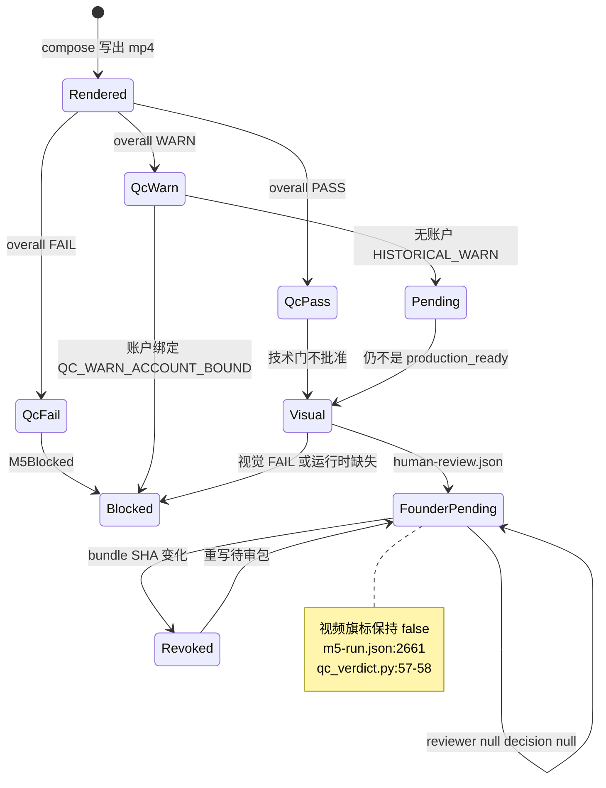
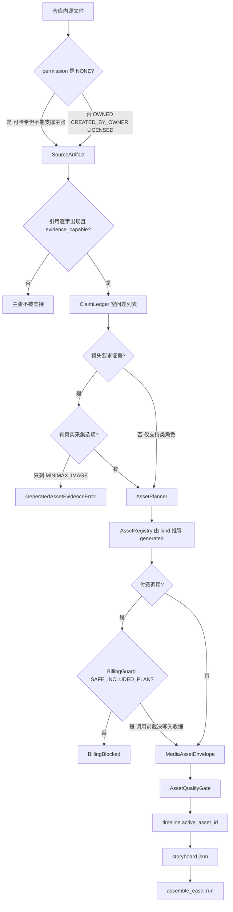
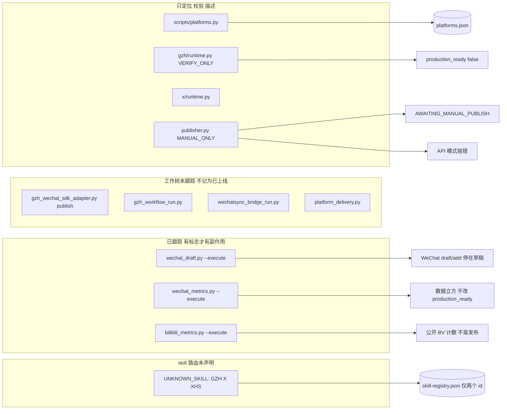
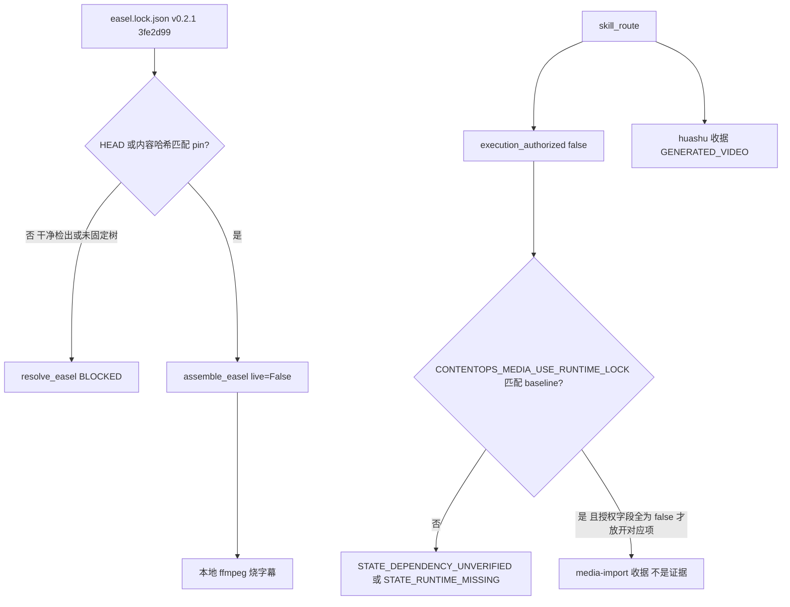

# 架构审计 2026-11-10

本文是起点到成片的地图，供功能决策时对照上下文。依据是六份子系统报告（`map:cli-m5`、`map:contentops-core`、`map:platforms`、`map:easel-mediause`、`map:receipts-qc`、`map:routing`）对仓库树的交叉核对。标识符与路径保持代码写法。不提出改造建议。不建立 `architecture-map/`。

报告之间有一处阶段顺序分歧，见第 2 节开头。其余结论按报告给出的 `path:line` 落地。工作树里未跟踪的脚本只记为磁盘上存在，不记为分支已交付。

## 1. 系统上下文

仓库是一条证据优先的视频生产库，加上只读或人工发布的平台层。没有常驻进程。人在命令行触发。两条合成入口共用同一个合成适配器，都不发布。

`src/contentops` 是失败即关闭的策略库，不是发布器（`map:contentops-core`）。`scripts/m5_production.py` 不导入 skill execution gate（`skills/execution_gate.py:30-32`）。平台注册表回答问题，不渲染、不发布、不花钱（`src/contentops/platforms/registry.py:15`，`scripts/platforms.py:6-7`）。

## 2. 端到端 M5 流程

**报告分歧。** `map:receipts-qc` 把模块 docstring 的阶段表当作已交付顺序，引用 `scripts/m5_production.py:6-7`（sources、claims、script、narration、subtitles、storyboard、compose、QC、visual QC、review）。`map:cli-m5` 指出同一 docstring（`:6`）漏掉 bundle、media_use、assets、motion、avatar，代码顺序在 `scripts/m5_production.py:2452-2654`。本文流程图按代码顺序，不按 docstring，也不按 `docs/CURRENT-STATE.md:176-204`。

每个门是判断节点。属主写在图后散文里。

属主文件：

| 门 | 属主 |
|---|---|
| 脏 `main` | 只守 `produce()`（`scripts/produce_video.py:592-594` 调用 `:554-562`）与 `m5_production.build`（`scripts/m5_production.py:2409-2441`）。`projects/_local/` 豁免。CLI 在调用 `produce()` 之前就能建项目 |
| 原始项目脚手架 | `scripts/produce_video.py:882-891` 调用 `raw_video_inputs.prepare_raw_project`（`scripts/raw_video_inputs.py:28` 导入 `new_project.create_project`）。无 `--project` 的运行先写目录，再在 `produce()` 里拒绝 |
| brief 是否重写 | `scripts/produce_video.py:402-427`。已完整的 M5 脚本不重写 |
| STRICT 文案门 | `scripts/produce_video.py:726-731` 仅在 `mode == STRICT` 时调用 `copy_review.require_approved`。预览旗标在 `:449`（`preview = mode in {AUTO, REVIEW}`），`allow_unapproved_preview` 传在 `:475` 与 `:490` |
| M5 内文案门 | `scripts/m5_production.py:2494-2506`。仅当 `require_copy_review` 为真才挡 brief 项目。没有 `00_brief/brief.json` 的项目不回溯拦截 |
| 摘要复用 | `scripts/produce_video.py:661-676`。复用收据仍是 `production_ready: false`，`published: false`（`:665-671`） |
| bundle | `scripts/m5_production.py:210-219`。未配置写 `NOT_CONFIGURED`，不是失败 |
| sources | `scripts/m5_production.py:269-313`。yaml `source_refs` 加 `sources/source-refs.json` |
| media_use | `scripts/m5_production.py:341-349`。可选许可导入，不是第二套渲染器 |
| claims | `scripts/m5_production.py:2518`。`ClaimLedger` 对源工件 |
| narration | `scripts/m5_production.py:1163-1166`，`:2526-2529`。未知值拦截。未配置时默认仍是 `sapi` |
| motion | 配置了才跑 Huashu，然后刷新清单（`map:cli-m5` 对 `:2452-2654` 的阶段表） |
| avatar | `scripts/m5_production.py:2475-2492`，`:2561-2604`。失败不中止正文（`:2595-2604`） |
| compose | `scripts/m5_production.py:1674-1698` 调用 `assemble_easel.run` |
| 技术 QC | `scripts/qc_video.py` 由 `:2170-2173` 调用。`blocked` 抛 `M5Blocked`（`:2216-2217`）。账户绑定的 WARN 也不能继续（`src/contentops/media/qc_verdict.py:69-76`） |
| 视觉 QC | `scripts/m5_production.py:2228-2329`。缺 Huashu 运行时在 `:2270-2284` 抛 BLOCKED。FAIL 与其后的 BLOCKED 在 `:2328-2329` 抛 `M5Blocked` |
| 审阅包 | `scripts/m5_production.py:2358-2406`。`reviewer`、`decision` 为空。bundle SHA 变化会撤销已填写的审阅（`:2366-2404`） |
| 跳过合成 | `scripts/m5_production.py:2606-2609`。同时跳过 QC 与审阅，`human_review` 为 `NOT_RUN` |

`produce_video` 再判一次 QC，写 `produce-video.json`。状态是 `QC_PASSED`、`QC_WARN_HISTORICAL`、`BLOCKED`、`FAILED`。`published` 保持 false（`scripts/produce_video.py:783-791`，`:720`）。

并行旧入口 `scripts/run_v1.py` 不经过上述链。它要求已写好的 `script/master.md` 与 `script/storyboard.json`，easel 引擎始终要求文案批准（`:293-300`），然后调用同一个 `assemble_easel.run`（`:394-395`）。状态串是 `READY_FOR_HUMAN_REVIEW`，不是 `PENDING_FOUNDER_REVIEW`（`:403-404`）。fallback 引擎只写 `final/fallback.mp4`（`:518-560`），且把主机路径写入 `project.yaml`（`:537-539`）。

## 3. 组件名册

状态只用 shipped、parked、planned。planned 不画成已上线。

| 名称 | 状态 | 角色 | 关键位置 |
|---|---|---|---|
| `new_project` | shipped | 只建目录与 `project.yaml` | `scripts/new_project.py:1-76` |
| `content_route` | shipped | 选题状态机。`APPROVED_FOR_PRODUCTION` 只表示 brief 可进流水线 | `src/contentops/routing/router.py:39-42` |
| `brief_to_m5` | shipped | 把 brief 草稿转成 M5 JSON。`produce_video` 不调用这个 CLI | `scripts/brief_to_m5.py:1-20`；包装器直接导入 `m5_bridge`（`scripts/produce_video.py:444`） |
| `produce_video` | shipped | 当前 brief 感知包装器 | `scripts/produce_video.py:565-891` |
| `m5_production` | shipped | 证据优先阶段运行器。结束时 `production_ready: false` | `scripts/m5_production.py:14-15`，`:2661` |
| `run_v1` easel | shipped | 并行旧入口，不是 M5 链 | `scripts/run_v1.py:269-413` |
| `run_v1` fallback | shipped | 诊断用，不是生产 | `scripts/run_v1.py:16-17`，`:518-560` |
| `assemble_easel` | shipped | 唯一合成适配器 | `scripts/assemble_easel.py:1-28`，`:170-252` |
| Easel pin | shipped | 锁已提交。树不在 git 里 | `runtime/easel.lock.json:2-6` |
| Easel 树 | parked | 干净检出没有引擎。`resolve_easel` 返回 `BLOCKED` | `scripts/resolve_easel.py:177-213` |
| media-use baseline | shipped | 批准范围只限离线本地资产操作 | `runtime/media-use-runtime-baseline.json:3-24` |
| media-use 执行 | parked | 干净检出无机器锁，外部执行关闭 | `src/contentops/media/media_use_adapter.py:554-568` |
| Huashu motion | shipped | 本地草稿渲染。账户生产未验证 | `scripts/huashu_motion_adapter.py:338-351`；`runtime/skill-registry.json:121-124` |
| `skill_route` | shipped | 发现加解析。每个裁决 `execution_authorized: false` | `scripts/skill_route.py:485-486` |
| skill registry | shipped | 只声明 `media-use` 与 `x-superplay-huashu-motion` | `runtime/skill-registry.json:12`，`:73` |
| GZH / X / XHS 作为 skill | parked | 故意不在注册表。解析为 `UNKNOWN_SKILL` | `runtime/skill-registry.json:3`；`scripts/skill_route.py:507-509` |
| 平台注册表 | shipped | 问答。没有任何行是 `PRODUCTION_ACCEPTED` 或 `PILOT_READY` | `config/registry/platforms.json`；`registry.py:253-257` |
| GZH runtime | shipped | VERIFY_ONLY。权利未清 | `src/contentops/gzh/runtime.py:10-20` |
| `wechat_draft` / `wechat_metrics` | shipped | 带 `--execute` 才有副作用。登记已承认草稿与数据立方，状态仍是 `PLANNED` | `scripts/wechat_draft.py:2-16`；`platforms.json:128-139` |
| `bilibili_metrics` | shipped | `--execute` 读公开计数。登记 `metrics` 已是 `API`，发布仍是 `NOT_IMPLEMENTED`，状态仍是 `PLANNED` | `scripts/bilibili_metrics.py:2-20`；`platforms.json:52-61` |
| X publisher | shipped | `MANUAL_ONLY`。`PublishMode.API` 抛错。无分支返回 `PUBLISHED` | `src/contentops/publish/publisher.py:5-6`，`:39` 是 `AWAITING_MANUAL_PUBLISH`，抛错在 `:172-176` |
| XHS | planned | 只有注册表行。`scripts/` 无适配器 | `platforms.json:61-82` |
| 视频平台行 | planned | douyin、bilibili、xiaohongshu_video、shipinhao、youtube 为 `PLANNED` / `NOT_IMPLEMENTED` | `platforms.json` 视频行 |
| `gzh_workflow_run` 等 | parked | 工作树未跟踪，不是分支已交付 | 对话 git 快照 `??` |
| Web workbench | parked | 文档记为 NOT VERIFIED，不是流水线阻断 | `docs/CURRENT-STATE.md:212-223` |
| workflow gate | shipped | 文案到视频的另一份合同，不是 M5 阶段表 | `src/contentops/workflow/contract.py:69-80` |
| Golden A/B | shipped | 实验机械。选择不自动填写 | `src/contentops/golden/review.py:16-17` |

## 4. 审阅与 production_ready 的数据生命周期

视频级 `production_ready` 是人写下的决定，不是从 QC 推断的。这些模块里没有任何路径把它写成 true。资产级 `quality_gate.GATE_PRODUCTION_READY` 不是视频旗标。

资产门是另一条状态，不要和视频旗标画成同一个枚举：

- 校验失败到 `BLOCKED`（`src/contentops/media/quality_gate.py:159-166`）。
- 派生资产在批准分支之前返回 `PENDING_HUMAN_REVIEW`，本函数内不会变成 `PRODUCTION_READY`（`:185-198`）。
- 记录的拒绝到 `REJECTED`。记录的人审批准到 `PRODUCTION_READY`（`:209-216`）。
- 声明的回退且无人审到 `DEGRADED_FALLBACK`，不会自己升级（`:230`）。
- 时间线只接受 pending review、production-ready、degraded fallback。`BLOCKED` 与 `REJECTED` 不能占槽（`:261-266`）。
- `usable` 包含 `DEGRADED_FALLBACK`（`:121-127`）。可合成不等于可生产。

workflow 门写的是 `workflow.json` 里的阶段状态 `blocked` / `ready_for_review` / `approved`。批准需要同 sha256、具名审阅者、`confirm=True`，没有 `--force`（`src/contentops/workflow/gate.py:144-174`）。它不写视频 `production_ready`。

选题批准 `APPROVED_FOR_PRODUCTION` 只表示 brief 可以进入流水线（`src/contentops/routing/router.py:39-42`）。桥接收据写明 M5 仍结束在 `PENDING_FOUNDER_REVIEW`（`src/contentops/script/m5_bridge.py:374-375`）。

## 5. 从源到合成的核心变换

规则落点：

- `permission: NONE` 能哈希，不能支撑主张（`src/contentops/evidence/source_artifact.py:7-10`，`:89`）。
- 引用必须出现在文本里。非文本定位符不算引用（`src/contentops/evidence/claim_ledger.py:101-122`）。
- 生成媒体永远不是证据（`src/contentops/media/image_contract.py:48-54`，`:111-122`）。调用方不能对 `GENERATED_IMAGE` / `GENERATED_VIDEO` 传入 `generated=False`（`:309-331`）。
- 计费只接受订阅类 `sk-cp-`。`sk-api-` 是 PAYG，拒绝。余额读不出绝不当成零（`src/contentops/billing_guard.py:63-64`，`:183-197`，`:361-389`）。
- 合成读时间线，不迭代库存（`src/contentops/media/quality_gate.py:270-290`）。
- 用户资产导入设 `evidence_capable: false`（`scripts/m5_production.py:2459-2464`）。

## 6. 平台集成：执行与只描述

平台注册表行不是 skill 声明，也不是执行授权。skill 解析只精确匹配 `runtime/skill-registry.json`。未命中是 `UNKNOWN_SKILL`，命中仍然 `execution_authorized: false`（`scripts/skill_route.py:485-509`）。

执行与只描述的对照：

| 路径 | 行为 | 依据 |
|---|---|---|
| `scripts/platforms.py` | 只读 `list` / `accounts` / `resolve` / `check` | `scripts/platforms.py:6-13` |
| `src/contentops/gzh/runtime.py` | 定位、哈希校验、描述。不运行、不草稿、不发布 | `:10-20`，`:51-66` |
| `src/contentops/publish/publisher.py` | 人工打包。没有任何分支返回 `PUBLISHED`。`API` 抛错。`:39` 是 `AWAITING_MANUAL_PUBLISH` | `:5-6`，`:172-176` |
| `src/contentops/x/runtime.py` | 只检查本地文件并列出人工命令 | `:36-48` |
| `scripts/wechat_draft.py` | 离线塑形。`--execute` 才 token、material/add、draft/add、draft/get。没有群发 | `:2-16`，`:47-50` |
| `scripts/wechat_metrics.py` | `--execute` 读官方数据立方。文件内没有 `production_ready`。`:31-32` 是 import | `:2-21` |
| `scripts/bilibili_metrics.py` | `--execute` 只读公开计数。无 BV 则拦截，不猜测。文件内没有 `production_ready`。`:34-41` 是 import 与 `sys.path` | `:2-20`，`:16-18` |
| `delivery_gate` | 只允许 `mode=draft`。抖音无条件拒绝。这是决定，不是发布器 | `delivery_gate.py:61-68`，`:127-155` |
| `video_delivery` | 默认 `PACKAGE_ONLY`。有 grant 可到 `ELIGIBLE_TO_EXECUTE`。URL 状态是 `URL_RECORDED_BY_OPERATOR`，不是 `PUBLISHED` | `src/contentops/platforms/video_delivery.py:11-25`，`:54-56`，`:74-77` |
| XHS | 注册表 `PLANNED`，`RIGHTS_UNRESOLVED`，仓库内无适配脚本 | `platforms.json:61-82` |

`graphic-platforms.yaml` 可以描述注册表仍标为未实现的渠道。两份报告都说这种不一致是有意的（`delivery_gate.py:18-23`，`video_specs.py:22-27`）。YAML 渠道不是 `PILOT_READY`。

视频行全部是 `PLANNED`，同时 `video_delivery` 在有 grant 时可以变成可执行。地图若画成“视频平台已接通”与代码不符。与代码相符的是：门存在，默认只打包。

## 7. 编排守卫

守卫事实：

- 不要自动升级 Easel（`runtime/easel.lock.json:6`）。未固定 HEAD、外来 remote、缺少 `assemble.py` / `tts.py` 都不是生产引擎（`scripts/resolve_easel.py:117-173`）。
- 干净检出没有 `.runtime/easel` 时是 `BLOCKED`（`scripts/resolve_easel.py:207-212`）。
- `assemble_easel` 用 `live=False`。git HEAD 匹配 pin 就足以合成，不做 blob 现场校验（`scripts/assemble_easel.py:44-49`）。
- 内容校验离线不能通过，离线是 `UNVERIFIED` 不是通过（`scripts/verify_easel_runtime.py:64-68`）。
- 锁文件缺失或损坏时，`resolve_easel` 静默使用同一硬编码 pin，而不是失败关闭（`scripts/resolve_easel.py:44-63`）。这是代码行为，不是第二套 pin。
- skill 路由每条路径都把 `execution_authorized` 写成 false（`scripts/skill_route.py:485-486`，`:589`）。注册表 `authorizes_execution: false`（`runtime/skill-registry.json:69`，`:129`）。
- `RESOLVABLE` 只表示交给具名适配器，不是执行授权（`scripts/skill_route.py:36-38`，`:564-568`）。
- `path_permitted: true` 是离线路径策略，不是执行授权（`runtime/skill-registry.json:46-51`）。
- 路由器运行时状态在环境变量未设时用 `MISSING`（`scripts/skill_route.py:427-432`）。适配器不用字符串 `MISSING_RUNTIME`，而用 `RUNTIME_MISSING` 与 `DEPENDENCY_UNVERIFIED`（`src/contentops/media/media_use_adapter.py:554-568`）。`map:easel-mediause` 明确记下这个用词差。
- media-use 默认 `allow_network` / `allow_paid` / `allow_cross_project_reuse` 为 false（`media_use_adapter.py:350-356`）。不支持的类型 `voice` / `video` / `grade` / `lut` / `recipe` 被拒绝（`:165-187`）。
- baseline 批准明确不授权生产就绪或许可（`runtime/media-use-runtime-baseline.json:24`）。
- Huashu 输出强制 `production_ready: False`，`publish_authorized: False`，`evidence_capable: False`（`scripts/huashu_motion_adapter.py:338-351`）。注册表验证是 `WINDOWS_SMOKE_PASS`，账户生产未验证（`runtime/skill-registry.json:121-124`）。证据路径 `.verify-tmp/...` 是本机专用，不是已提交收据。
- skill execution gate 是可选的。授权不替代权利检查或运行时锁（`src/contentops/skills/authorization.py:15-20`）。路由器裁决上的 `execution_authorized: true` 被视为不可信（`:31-32`）。Legacy M5 不导入这个门。
- 后台子进程必须走 `scripts/process_utils.py`。`gzh_workflow_run.py` 使用裸 `subprocess.run`（`:40-44`）。该文件未跟踪，且其“凭据齐了发布链就接通”的字符串与 VERIFY_ONLY 注册表行冲突。以注册表行为准。

## 8. 治理上的不做

这些是代码与仓库规则已经拒绝的事，不是建议清单。

| 不做 | 落点 |
|---|---|
| 这些 CLI 不发布 | `produce_video` 收据 `published: false`（`scripts/produce_video.py:720`）。`publisher.py` 无 `PUBLISHED` 分支 |
| 不把视频 `production_ready` 设为 true | `scripts/m5_production.py:14-15`，`:2207-2211`，`:2387`，`:2661`；`qc_verdict.py:4-6`；两个 `run_v1` 引擎（`:403`，`:558`） |
| 不从 QC PASS 推断人审 | `scripts/qc_video.py:16`。审阅文件明确不是批准（`scripts/m5_production.py:2397`） |
| 不把生成媒体当证据 | `GeneratedAssetEvidenceError`（`image_contract.py:48-54`） |
| 不静默把未知旁白降级到 SAPI | `scripts/m5_production.py:1163-1166`；`scripts/run_v1.py:302-305` |
| 不把 skill 解析当成执行或权利门 | `scripts/skill_route.py:485-486`；`authorization.py:15-20` |
| 不把未声明的 GZH / X / XHS 画成已接通 | `runtime/skill-registry.json:3` |
| 不自动升级 Easel，不改 `.runtime/easel/` 或 `Easel/` | `runtime/easel.lock.json:6`。规范 pin 只在 `runtime/easel.lock.json` |
| 不把 media-use 当第二套合成器 | `scripts/m5_production.py:341-349`；适配器拒绝 `video` 类型 |
| 不把 Huashu 当合成器或证据 | `scripts/huashu_motion_adapter.py:338-351` |
| workflow 批准没有 `--force` | `src/contentops/workflow/gate.py:15-16` |
| 选题批准不是发布 | `src/contentops/routing/router.py:39-42` |
| 指标脚本不含 `production_ready` | `scripts/wechat_metrics.py` 与 `scripts/bilibili_metrics.py` 全文无该旗标。`:31-32` 与 `:34-41` 只是 import / `sys.path` |
| 视频 URL 记录不是发布 | `src/contentops/platforms/video_delivery.py:74-77`（`URL_RECORDED_BY_OPERATOR`，不是 `PUBLISHED`） |
| 抖音投放无条件拒绝 | `delivery_gate.py:61-68` |
| 账户解析不做相似匹配 | `registry.py:300-309` |
| `manual_review` 必须保持 true，否则注册表加载失败 | `registry.py:229-231` |

## 9. 改哪里

| 要改的事实 | 先打开 | 不要打开 |
|---|---|---|
| M5 阶段顺序与门 | `scripts/m5_production.py:2452-2665` | 模块 docstring `:6`；`docs/CURRENT-STATE.md:176-204`（两者都落后于代码） |
| 包装器模式 AUTO / REVIEW / STRICT | `scripts/produce_video.py:402-505`，`:726-731` | 不要假设它会 shell 到 `brief_to_m5.py` |
| brief 到 M5 合同 | `src/contentops/script/m5_bridge.py` | CLI 只是第二入口 |
| 主张与证据 | `src/contentops/evidence/source_artifact.py`，`claim_ledger.py` | 生成资产收据 |
| 一条时间线一个资产 | `src/contentops/media/quality_gate.py:261-290` | 库存列表 |
| 付费前检查 | `src/contentops/billing_guard.py` | `contract.py` 里残留的 `payg_allowed` 布尔（策略不在那里） |
| 合成 | `scripts/assemble_easel.py` | `.runtime/easel/`、`Easel/`、上游 `assemble.py` |
| Easel 身份 | `runtime/easel.lock.json` | 硬编码回退（`scripts/resolve_easel.py:44-63`）不是第二 pin |
| media-use 可否运行 | baseline JSON 加机器锁校验 `media_use_adapter.py:543-616` | 路由器的 `RESOLVABLE` |
| 哪个 skill 名可交接 | `runtime/skill-registry.json` | `skills/` 目录里被发现但未声明的 SKILL.md |
| 平台诚实状态 | `config/registry/platforms.json` 与 `registry.py` | 未跟踪脚本里的“已接通”字符串 |
| 微信草稿副作用 | `scripts/wechat_draft.py` 与 `src/contentops/platforms/wechat_draft.py` | `gzh/runtime.py`（那条是 VERIFY_ONLY） |
| X 人工发布包 | `src/contentops/publish/publisher.py`，`src/contentops/x/runtime.py` | skill 路由（解析 X 会 `UNKNOWN_SKILL`） |
| 技术 QC 严重级别 | `scripts/qc_video.py:38-44`，`:279-457` | 文件名 `qc-report-*.json`（货币性在 `graded_target` 与 `currency`） |
| 视频能否继续 | `src/contentops/media/qc_verdict.py:39-80` | `qc_video` 退出码（WARN 也是 0） |
| 选题 | `scripts/content_route.py`，`src/contentops/routing/router.py` | 热点记录里的 `published_at`（那是条目时间戳） |
| 文案到视频的阶段合同 | `src/contentops/workflow/contract.py`，`workflow/gate.py` | 不要把它画成 M5 链 |

## 10. 观察

### 重复入口

- 三条路径到达同一个 `assemble_easel.run`：`m5_production.stage_compose`、`run_v1.run_easel`、`assemble_easel` CLI。只有 M5 接着跑 QC、视觉 QC 和创始人审阅包。`run_v1` 用状态 `READY_FOR_HUMAN_REVIEW` 和语音标签 `edge_tts_fallback`，不是 M5 审阅模式（`map:cli-m5`）。
- `produce_video` 不调用 `scripts/brief_to_m5.py`。它直接导入 `contentops.script.m5_bridge`（`scripts/produce_video.py:444`，`:489`）。CLI 是同一座桥的第二入口。
- 微信有三条路径，不是一条：（1）`gzh/runtime.py` 只校验；（2）已跟踪的 `wechat_draft.py`；（3）未跟踪的 `gzh_wechat_sdk_adapter.py`，命令名是 `publish`，仍停在 `draft/get`（`:224-225`）。另有未跟踪的 Wechatsync `weixin`。四者都不在 `skill-registry.json`。
- `canonical.py` 只是路由与热点用的字节稳定哈希（`canonical.py:24-37`）。工作流合同在 `workflow/contract.py`。两者不是同一个对象。
- `contract.py:29-31` 仍写故意不建 `MediaProviderRegistry`。`media/capability_registry.py` 是另一份显式执行器注册表，不含发现、不含凭据（`capability_registry.py:23-24`）。`map:contentops-core` 标明这句过时。

### 未声明但仍在仓库里的平台适配器

- GZH：已跟踪的 VERIFY_ONLY 适配器在 `src/contentops/gzh/runtime.py`。注册表行 `execution_authorized` 与 `publish_authorized` 为 false（`platforms.json:140-141`）。skill 解析 GZH 是 `UNKNOWN_SKILL`。
- X：平台注册表是 `INTEGRATED` / `MANUAL_ONLY`（`platforms.json:145-179`）。skill 注册表故意没有 X（`skill-registry.json:3`）。用“解析 X skill”去接 M5 会未命中，不是接线。
- XHS：`xiaohongshu_video` 是 `PLANNED`，权利未清，`scripts/` 中没有 `*xhs*` 适配器。上游 skill 路径 `verified_here: false`（`platforms.json:63-82`）。`platforms.json` 没有 `xiaohongshu_image` 行（文件在 youtube 处结束，`:229-249`）。
- 已跟踪命令与登记的关系，以 2026-11-10 登记更正之后为准：`platforms.json:128-139` 承认微信草稿与数据立方，`publish_mode` 为 `DRAFT_ONLY`，`metrics` 为 `API`。`platforms.json:52-61` 承认 B 站公开计数，`metrics` 为 `API`，发布仍是 `NOT_IMPLEMENTED`。两行 `status` 仍是 `PLANNED`，因为非 `PLANNED` 必须绑定公开账号，而公开注册表只有 `x-superplay-english`（`registry.py` 的 `PLATFORM_ACCOUNT_MISSING`）。不要画成没有代码，也不要画成已接受的发布器。审计当时写的「注册表否认代码存在」已被这次更正取代。
- 工作树未跟踪、对话 git 快照为 `??` 的文件：`scripts/gzh_workflow_run.py`、`gzh_wechat_sdk_adapter.py`、`platform_delivery.py`、`wechatsync_bridge_run.py`、`wechatsync_browser.py`、`wcs_bridge.py`、`wcs_login.py`。它们在这块工作区磁盘上。它们不是默认分支会发布的证据。

### 文档写了但代码没有，或代码有而文档没有

- `docs/CURRENT-STATE.md`（Pipeline 与 M5 节，日期 2026-10-31 / 2026-11-04）落后于代码：漏掉 `produce_video`、media-use、motion、avatar、视觉 QC，并把 M5 旁白写成仅 SAPI。代码在未另行配置时默认仍是 `sapi`（`scripts/m5_production.py:2526-2529`），但 `minimax` 与 `existing` 已交付。
- `docs/CURRENT-STATE.md:124` 写 M5 拒绝未经审阅的 brief 项目。代码允许 AUTO/REVIEW 在没有文案批准时做本地渲染，并写明发布仍是分开的门（`scripts/m5_production.py:2499-2506`，`scripts/produce_video.py:446-449`）。STRICT 仍然拦截。不要把 AUTO 画成已过文案门。
- `scripts/m5_production.py:6` 的阶段表与 `map:receipts-qc` 引用的 `:6-7` 都短于 `:2452-2654` 的代码顺序。以代码顺序为准。
- `workflow/contract.py:66-68` 声称那些阶段是仓库在跑的阶段。那是文案到视频合同，不是仓库文档里的 M5 证据链。不要把 M5 画成 brief、audience、research、script、audio、storyboard、assets、compose、quality、delivery。
- 平台登记的字段已与已跟踪的微信、B 站指标代码对齐。状态没有升高。见上一小节。
- Easel skill 路径 `skills/openclaw/...` 出现在视频与 GZH 行上，是上游声明，不是本机已验证能力（`platforms.json:15-20`，`registry.py:47`，`:262-271`）。
- 注册表对 media-use 的 `verification.status: VERIFIED` 是带证据路径的审计声明（`runtime/skill-registry.json:60-64`）。它不使干净检出可执行。
- Golden 锁允许 `claim_refs` 为空，因为那次实验没有绑定账本（`golden/evidence_lock.py:14-16`）。账本模块本身已交付。空引用是锁上的缺口，不是“主张未实现”。

### 其他已核对、易画错的事实

- 复用不是批准。AUTO 摘要复用返回 `state: QC_PASSED`，同时 `production_ready: false`（`scripts/produce_video.py:665-671`）。
- avatar 失败不使正文视频失败。部分 avatar 写单独的 `*-avatar-preview.mp4`，不替换被评分的成片（`scripts/m5_production.py:2631-2636`）。
- `--skip-compose` 跳过的不止合成（`scripts/m5_production.py:2606-2609`）。
- 镜头数比例 `real_source_ratio` 只是诊断 WARN。测量门是 `real_source_duration_ratio`（`scripts/qc_video.py:416-432`）。解说格式与账户 DNA `EXPLANATORY` 把 70% 下限降到 0.0（`:98-116`，`:455-456`）。主张校验是另一件事。
- `qc_video` 的 markdown 由未消毒的 `checks` 建成，`.md` 仍可能含机器路径（`scripts/qc_video.py:582-609`）。M5 对 slug 报告只用 `render_canonical_qc_markdown`（`m5_production.py:2213-2214`）。
- 多个 `qc-report-*.json` 可以并存。文件名不是货币性。读 `graded_target` 与 `currency`（`qc_canonical.py:21-26`）。
- 目录发现不等于授权。`.runtime/`、`Easel/`、`vendor/` 在目录根里（`scripts/skill_route.py:56-61`）。带 `unverified-vendor` 的 gzh skill 可以出现在发现结果里，`--resolve` 仍是 `UNKNOWN_SKILL`。
- `content_route.py approve` 看起来像发布命令。它确认的是 brief 摘要可以进流水线，并打印文案审阅仍是渲染门（`scripts/content_route.py:303-325`）。
- 热点适配器对 NewsNow 与 GitHub 会发起网络调用。那是采集，不是发布，且只针对允许列表中的源。只有 `github-search` 是 `NATIVE_SEARCH`。NewsNow 与 TrendRadar 是 `LIST_ONLY`（`src/contentops/hotspots/source_registry.py:16-29`）。
